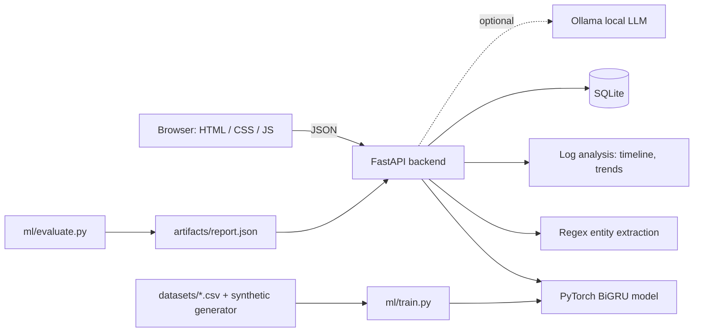

# AI System Failure Investigator

Paste a log or error from an AI system (LLM app, RAG pipeline, agent, ML service) and a small trained model (built with PyTorch) tells you what kind of failure it is, how sure it is, which words gave it away, and what to check first. It can also analyze whole log files, track investigations in a database and compare itself with a classic NLP baseline.

**Safety by design:** it only gives suggestions. It never changes any system by itself.

**Stack (all free, no paid APIs):** HTML + CSS + JavaScript (no build step) · Python · FastAPI · PyTorch (CPU) · scikit-learn · SQLite · pytest · Docker · GitHub Actions. Ollama is optional.

## Features

| Area | What it does |
|---|---|
| Diagnosis | BiGRU classifier over 9 failure types, severity, confidence, probability bars |
| Evidence | Highlights the words that influenced the prediction (token occlusion) |
| NLP extraction | Regex entities: timestamps, HTTP codes, latencies, exceptions, memory sizes, request IDs |
| Unknown handling | Refuses to guess when the model is unsure or most words are unfamiliar |
| Log file analysis | Upload or paste up to 500 lines: per-line diagnosis, timeline chart, rising-trend alerts |
| Similar incidents | Finds earlier investigations with similar model embeddings |
| Storage | SQLite history (`data/aifsi.db`), survives restarts |
| Reports | Download Markdown, or a printable page you can save as PDF |
| AI summary | Optional plain-English summary from a free local model (Ollama) |
| Dashboard | Counts by category and severity, recent log runs |
| Model overview | Compares TF-IDF + Logistic Regression with the BiGRU, with confusion matrix |
| Engineering | pytest suite, Dockerfile, GitHub Actions CI |

## Architecture



## Project layout

```
ai-system-failure-investigator/
├── ml/              textproc.py (tokenizer) · common.py (model) · dataset.py (synthetic logs)
│                    data.py (CSV loading) · train.py · evaluate.py
├── backend/         main.py (API) · storage.py (SQLite) · loganalysis.py · incident_report.py
│                    nlp_utils.py (entities + advice) · ollama_client.py
├── frontend/        index.html · style.css · app.js
├── datasets/        custom_logs.csv (your TRAINING lines) · holdout_logs.csv (TEST lines, never trained on)
├── tests/           pytest suite
├── Dockerfile · requirements.txt · requirements-dev.txt · .github/workflows/ci.yml
└── artifacts/ data/ created automatically (model files, evaluation report, database)
```

## Run it (Windows PowerShell)

```powershell
cd path\to\ai-system-failure-investigator
python -m venv .venv
.venv\Scripts\Activate.ps1            # if blocked: Set-ExecutionPolicy -Scope CurrentUser RemoteSigned
python -m pip install torch --index-url https://download.pytorch.org/whl/cpu
python -m pip install -r requirements.txt
python ml\train.py                    # about a minute; creates artifacts\model.pt
python ml\evaluate.py                 # optional, a few minutes; creates the Model overview report
uvicorn backend.main:app --reload     # wait for "Application startup complete"
```

Open **http://127.0.0.1:8000**. Run all commands from the project root.

> **Upgrading from the earlier version?** The model code changed, so run `python ml\train.py` again before starting the server.

### The four tabs
1. **Investigate**: click an example chip (try *Unclear* to see the unknown handling), then **Investigate**.
2. **Log file analysis**: click *Load a sample log*, then **Analyze log**. Or upload any `.log` / `.txt` file.
3. **Dashboard**: totals and charts from everything you have analyzed.
4. **Model overview**: needs `python ml\evaluate.py` first.

### Optional: AI-written summaries (free, local)
Install Ollama from ollama.com, then `ollama pull llama3.2:1b`, keep Ollama running, and click **Write AI summary**. Nothing leaves your PC. Without Ollama the button shows a friendly message and everything else works.

## Run the tests

```powershell
python -m pip install -r requirements-dev.txt
python -m pytest
```
The API tests train a tiny model first (about 10–20 seconds).

## Docker (optional)

```powershell
docker build -t aifsi .
docker run -p 8000:8000 -v aifsi-data:/app/data aifsi
```

## How honest is the accuracy?

The training logs are template-generated, so a random train/test split is **too easy**. `ml/evaluate.py` runs three experiments:

| Experiment | What it tests |
|---|---|
| Random split | Same templates in train and test. Looks perfect, tells you little. |
| Held-out templates | Test wording patterns the model never saw during training. |
| Handwritten holdout | 54 lines written by hand in different wording (`datasets/holdout_logs.csv`). |

For reference, a TF-IDF + Logistic Regression baseline scores 100% / 71% / 76% on these three. Run `evaluate.py` to see how the BiGRU compares. Report **those** numbers, not the random-split one.

## Make it better

1. **Add your own labelled lines** to `datasets/custom_logs.csv` (columns `text,label`), then retrain. This is the biggest improvement you can make. Never copy lines from `holdout_logs.csv`, or the test stops being fair.
2. Collect real error messages from the GitHub issues of open-source AI projects.
3. Try DistilBERT: `pip install transformers`, then `python ml\evaluate.py --bert` (slow on CPU).
4. Tune `AIFSI_UNKNOWN_THRESHOLD` (default 0.5) and `AIFSI_MIN_COVERAGE` (default 0.5) to trade off guessing against refusing.

## Troubleshooting

| Problem | Fix |
|---|---|
| `Model not found. Train first` | `python ml\train.py` |
| `ModuleNotFoundError` for `common` / `storage` | Start uvicorn from the project root |
| Page says "backend offline" | Server not running, or you opened `index.html` directly. Use http://127.0.0.1:8000 |
| "refused to connect" right after starting | Wait for `Application startup complete` (PyTorch takes a few seconds to load) |
| Model overview says "No evaluation report" | `python ml\evaluate.py` |
| Everything shows as "unknown" | The model was trained before this upgrade or on very little data. Retrain |
| `pip` crashes with "null bytes" | Delete `.venv` and recreate it |
| AI summary says it cannot reach Ollama | Install and start Ollama, then `ollama pull llama3.2:1b` |
